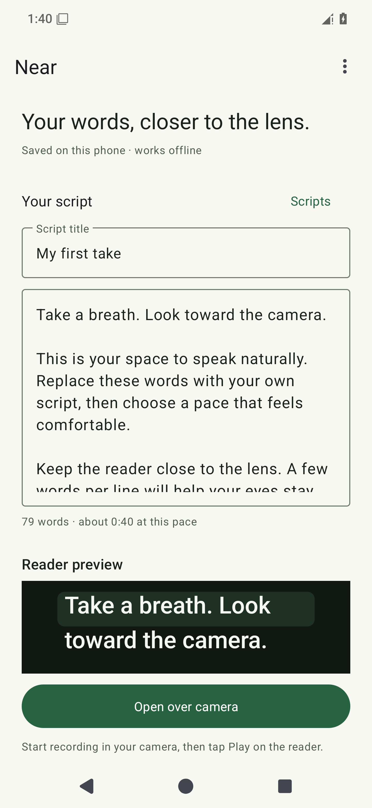
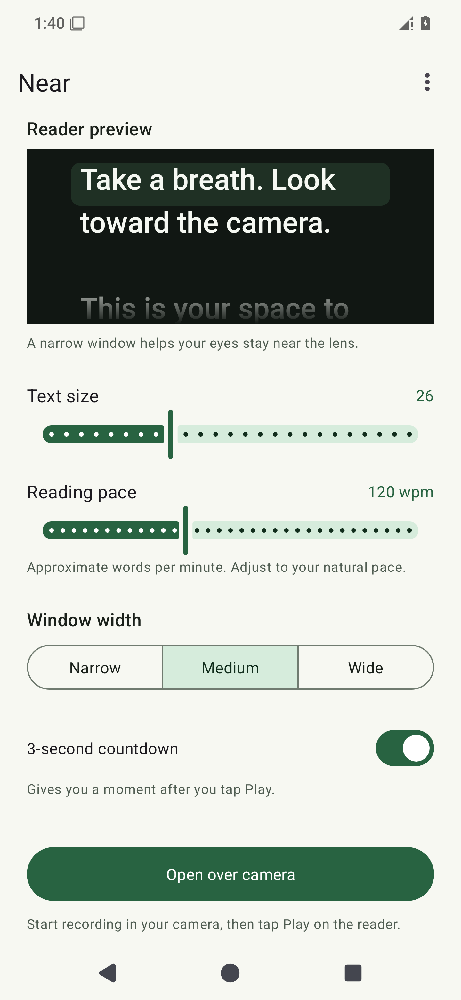
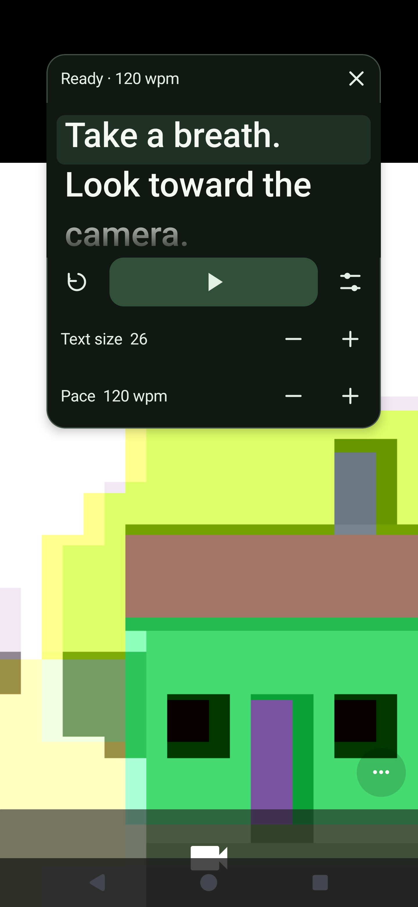

# Near · Offline Android teleprompter

Read a script close to the front camera while recording with your existing camera app. Near is a native Java Android app with a movable reader, local script storage, and manual auto-scroll.

**[Download the Android APK](https://github.com/Mastermoh0/near-teleprompter/releases/latest)** · **[Full build tutorial](TUTORIAL.md)** · **[Narration script](docs/tutorial-voiceover.txt)**

The main device target is Pixel 7 Pro. Android 8.0+ is the intended baseline. Emulator checks are complete; actual Pixel Camera recording still needs a real-phone test. Voice-follow scrolling is deferred.

<p>
  
  
  
</p>

Screenshots are native Android emulator renders. The camera scene is synthetic and is not footage from Pixel Camera.

## Install without building

1. On your Android phone, open [the latest release](https://github.com/Mastermoh0/near-teleprompter/releases/latest).
2. Under **Assets**, download the versioned `.apk` file. You do not need the source ZIP or Android Studio.
3. Open the APK in Files. If Android asks, allow that file manager/browser to install APKs, then install Near. Prompts vary by Android version and device policy.
4. Open Near, enter a script, and choose your text size, pace, and window width.
5. Tap **Open over camera**. Follow the first-time **Display over other apps** prompt, return, and tap the button again. Notifications are optional and provide another way to pause or close the reader.
6. In your camera app, choose **Video** and the **front camera**. Drag the reader's top bar close to the lens. Start recording using the camera's own button, then tap **Play** in Near.

Tap Play/Pause to control scrolling, swipe the text to go back or ahead, and use restart to return to the beginning. Reader settings adjust size and pace during a take. Closing or pausing Near does not stop your camera recording. Reopening from the editor applies edits and restarts the reader.

**Moving from the earlier personal debug APK?** Export your scripts first, uninstall that build, then install the public release. The public APK has a dedicated release signing key and cannot update over the old debug signature. Uninstalling removes app-local scripts.

## Features and privacy

- Script library with automatic local saving and UTF-8 text import/export.
- Text sizes 18–42 and reading pace approximately 60–220 words per minute.
- Three window widths, drag to move, and optional three-second countdown.
- Pause/resume, restart, and swipe to reposition the text.
- Frame-timed scrolling, light/dark themes, and larger-system-text support.
- Screen stays on while the reader is open; scrolling pauses when the screen locks.
- Visible close control and notification actions.

No account, server, analytics, or in-app network access. Near requests no internet, camera, microphone, or storage permission. Your camera app owns video and audio recording. Scripts stay in app-private storage; backup and device transfer are excluded by the app's backup rules. Export important scripts before uninstalling or clearing app data.

The document picker can show cloud providers installed on the phone. Choose local files for offline use. Some camera apps deliberately hide overlays, and Android can stop the service after a force-stop or under memory pressure. Make a short test take before an important recording.

## Learn how it was built

[TUTORIAL.md](TUTORIAL.md) is a complete YouTube-style teaching script: spoken narration, screen directions, checkpoints, code explanations, actual build problems and fixes, testing, signing, and GitHub publication. [tutorial-voiceover.txt](docs/tutorial-voiceover.txt) contains just the spoken narration, ready to import into Near.

The code is the source of truth. This project was built with assistance from OpenAI Codex and verified with local Android tools; AI assistance does not replace tests or actual phone validation.

## Build from source

Stack: Java 17, Android views, Material Components 1.13.0, AppCompat 1.7.1, Gradle 8.13, Android Gradle Plugin 8.13.0, compile/target SDK 36, min SDK 26. No backend or API keys.

On Windows with PowerShell 7:

```powershell
git clone https://github.com/Mastermoh0/near-teleprompter.git
cd near-teleprompter
.\scripts\setup-tools.ps1
.\scripts\build.ps1 -Verify
```

Initial tool/dependency downloads need internet. The installed app runs offline. `-Verify` builds a debug APK, runs JVM tests, and runs Android Lint. Debug output: `releases/near-teleprompter-1.0.apk`.

With Android Studio or an existing Java 17 / Android SDK installation, open this folder, sync Gradle, and install SDK platform 36/build tools 35.0.0. Run:

```sh
# macOS/Linux
bash gradlew assembleDebug testDebugUnitTest lintDebug
```

```powershell
# Windows
.\gradlew.bat assembleDebug testDebugUnitTest lintDebug
```

The wrapper pins and checksum-verifies Gradle 8.13. SDK locations belong in untracked `local.properties` or `ANDROID_HOME`.

Create your own signed release with the Windows helper:

```powershell
.\scripts\release.ps1 -CreateKey
```

Read [the release guide](docs/RELEASING.md) before publishing updates. Back up signing credentials privately. Forks should change `applicationId` and use their own signing identity.

## Project map

| File | Responsibility |
| --- | --- |
| [`MainActivity.java`](app/src/main/java/com/mastermoh/near/MainActivity.java) | Editor, library, settings, import/export, permissions, camera handoff |
| [`ScriptStore.java`](app/src/main/java/com/mastermoh/near/ScriptStore.java) | Local script persistence |
| [`PrompterSettings.java`](app/src/main/java/com/mastermoh/near/PrompterSettings.java) | Reader preferences and position |
| [`ScrollSession.java`](app/src/main/java/com/mastermoh/near/ScrollSession.java) | Pure frame-timed scrolling state |
| [`ReaderView.java`](app/src/main/java/com/mastermoh/near/ReaderView.java) | Text layout, drawing, and touch input |
| [`PrompterService.java`](app/src/main/java/com/mastermoh/near/PrompterService.java) | Floating window, notification, controls, and lifecycle |
| [`IconButton.java`](app/src/main/java/com/mastermoh/near/IconButton.java) | Drawn controls with spoken labels |
| [`activity_main.xml`](app/src/main/res/layout/activity_main.xml) | Native editor layout |
| [`AndroidManifest.xml`](app/src/main/AndroidManifest.xml) | Components and permissions |
| [`DESIGN.md`](DESIGN.md) | Built UI system and native interaction rules |
| [`design-system.json`](docs/design-system.json) | Design record; HTML/CSS examples are illustrative, not app runtime |

## Testing and automation

The initial build passed six JVM tests and two Android device-flow tests. Native screenshots cover light/dark, font scale 1.3, and portrait/landscape. Evidence and limits are in [VERIFICATION.md](VERIFICATION.md).

With an emulator or dedicated testing phone connected:

```powershell
.\gradlew.bat connectedDebugAndroidTest
```

For the local Windows tools, a direct ADB runner is also available:

```powershell
.\scripts\test-device.ps1 -Serial emulator-5554
```

Device tests temporarily change app preferences and restore them afterward. Export important scripts first and use a test installation.

GitHub Actions builds/tests/lints debug code on pushes and pull requests. Upstream signing credentials stay local, and the initial APK is published directly. An optional tag-release workflow is disabled until its signing secrets and enable variable are deliberately configured. Release assets include the APK, checksum, tutorial Markdown, and narration text.

Before relying on a real recording, check airplane mode, front-lens placement, camera video with microphone audio, pause/resume, rotation, and script persistence on that phone. Emulator results do not establish Pixel Camera hardware compatibility.

## Contributing and license

See [CONTRIBUTING.md](CONTRIBUTING.md). The app and original tutorial use the [MIT license](LICENSE). Dependencies retain their own licenses. Near is not affiliated with Google or Pixel Camera. Public APK distribution is separate from Google Play submission and applicable Android developer-verification requirements.
