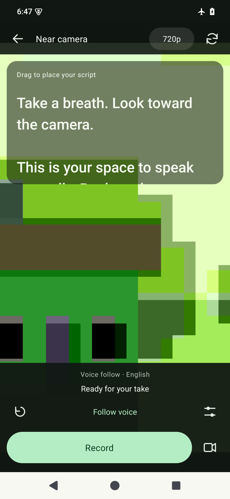
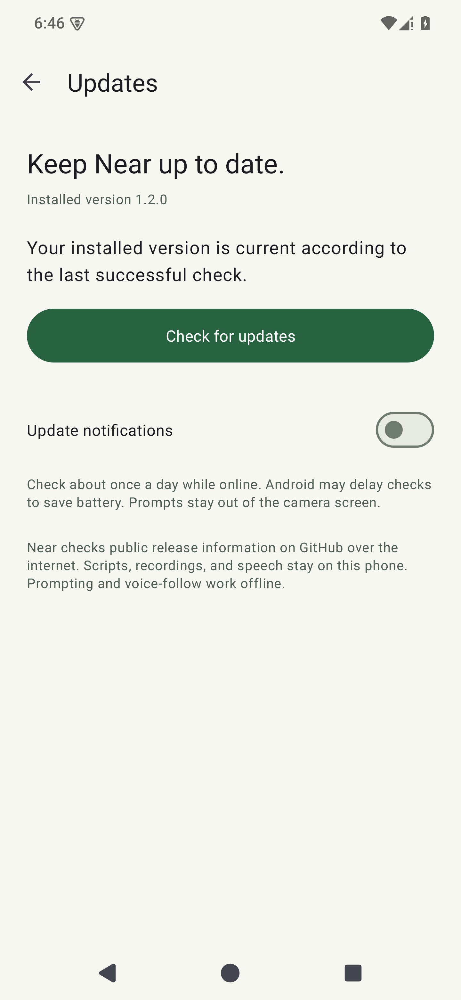

# Near · Offline Android teleprompter

Read a script close to the front camera while recording directly in Near or with your existing camera app. Near is a native Java Android app with local scripts, a translucent camera reader, fixed-speed scrolling, and offline English voice-follow in its built-in camera. Reading, recording, and speech recognition work offline; checking for updates uses the internet.

**[Download the Android APK](https://github.com/Mastermoh0/near-teleprompter/releases/latest)** · **[Full build tutorial](TUTORIAL.md)** · **[Narration script](docs/tutorial-voiceover.txt)**

The main device target is Pixel 7 Pro. Android 8.0+ is the intended baseline. Verification uses an Android emulator; actual Pixel camera, microphone, speech accuracy, and long-take behavior still need a real-phone test. Fixed pace remains available when speech recognition loses your place.

<p>
  
  
  
</p>

Screenshots are native Android emulator renders. The camera scene is synthetic and is not footage from Pixel Camera.

## Install without building

Open a script and tap **Record in Near**, allow camera and microphone access, then press Record. The countdown starts the take and the reader. Pause script pauses only the words; Stop recording saves the take. The camera toolbar changes lens and supported quality before a take; reader settings adjust text size, pace, and independent background/text opacity. Drag the reader header to move it. Review last take plays the saved video and offers Share video. Leaving the camera or rotating the phone during a take stops and saves it.

For **offline voice-follow**, open Reader settings in the camera and turn on **Voice follow · English** before a take. Wait for the bundled model to prepare. Record starts filming and listening; Follow voice also lets you rehearse without recording. Matching spoken words move the reader; silence holds its position. Pause script stops listening while video continues. Swipe to reposition, then resume. Turn voice-follow off for fixed pace; the pace slider controls that mode. Voice-follow is available in Near's camera, while the external floating mode uses fixed pace.

For **update alerts**, tap Get update alerts in the editor or choose **Updates** from its menu. Turn on Update notifications and allow Android notifications. Background alerts are off until you opt in. Near checks your official GitHub release roughly daily while online, with Android controlling the actual timing. The editor also checks at most daily and shows an available-update banner; failed requests back off. Check for updates makes a manual request. Open official download goes to the release page; you download the APK and approve Android's installation. Near does not download or install APKs automatically, and update prompts stay out of the camera and floating reader.

**Already using public 1.1?** Install 1.2 once manually to gain voice-follow and the update checker. Keep the app installed and install the new APK over it to retain scripts. Older versions cannot receive these new update notifications retroactively. The APK is about **90 MB** because it includes the offline English speech model.

Select text in another app and choose **Share → Near**. Review it, edit its title, and tap Save as new script. Cancel leaves the library untouched. Plain text up to 100,000 characters is supported; a shared URL stays a URL and is never fetched automatically.

The original external-camera workflow is also available:

1. On your Android phone, open [the latest release](https://github.com/Mastermoh0/near-teleprompter/releases/latest).
2. Under **Assets**, download the versioned `.apk` file. You do not need the source ZIP or Android Studio.
3. Open the APK in Files. If Android asks, allow that file manager/browser to install APKs, then install Near. Prompts vary by Android version and device policy.
4. Open Near, enter a script, and choose your text size, pace, and window width.
5. Tap **Open over camera**. Follow the first-time **Display over other apps** prompt, return, and tap the button again. Notifications are optional and provide another way to pause or close the reader.
6. In your camera app, choose **Video** and the **front camera**. Drag the reader's top bar close to the lens. Start recording using the camera's own button, then tap **Play** in Near.

Tap Play/Pause to control scrolling, swipe the text to go back or ahead, and use restart to return to the beginning. Reader settings adjust size and pace during a take. Closing or pausing Near does not stop your camera recording. Reopening from the editor applies edits and restarts the reader.

**Moving from the earlier personal debug APK?** Export your scripts first, uninstall that build, then install the public release. The public APK has a dedicated release signing key and cannot update over the old debug signature. Uninstalling removes app-local scripts.

## Features and privacy

- Script library with automatic local saving and UTF-8 text import/export.
- Text sizes 18–42 and reading pace approximately 60–220 words per minute.
- Three window widths, drag to move, and optional three-second countdown.
- Pause/resume, restart, and swipe to reposition the text.
- Frame-timed scrolling, light/dark themes, and larger-system-text support.
- Built-in front/rear recording with capability-based 1080p/720p selection, clean video output, and local playback/sharing.
- Independent script playback during a take and a translucent, movable camera reader.
- Offline English voice-follow using a bundled Vosk model, bounded word matching, and manual recovery.
- Optional daily update notifications, an in-app update notice, and manual checking against official stable GitHub releases with an uploaded APK.
- Incoming text review that creates a new script rather than replacing an existing draft.
- Screen stays on while the reader is open; scrolling pauses when the screen locks.
- Visible close control and notification actions.

No account, custom server, or analytics. Near requests camera and microphone permissions for built-in recording and voice-follow. Microphone denial offers an explicitly silent take with fixed pace. External-camera prompting continues to use the external camera's capture. Near now requests internet access for public GitHub release checks and a boot permission so Android can retain opted-in update jobs after reboot; it requests no broad storage permission. GitHub receives ordinary request metadata, including the connection's IP address and Near version. Scripts, speech, and videos are not sent with update checks. Scripts stay in app-private storage; backup and device transfer are excluded by the app's backup rules. Export important scripts before uninstalling or clearing app data.

On Android 10+, built-in videos save to Movies/Near through MediaStore. On Android 8–9, they stay in app-specific storage and can be shared from Review last take; those private recordings are removed if Near is uninstalled. Shared copies are controlled by the destination app.

The document picker can show cloud providers installed on the phone. Choose local files for offline use. Some camera apps deliberately hide overlays, and Android can stop the service after a force-stop or under memory pressure. Make a short test take before an important recording.

## Learn how it was built

[TUTORIAL.md](TUTORIAL.md) is a complete YouTube-style teaching script: spoken narration, screen directions, checkpoints, code explanations, actual build problems and fixes, testing, signing, and GitHub publication. [tutorial-voiceover.txt](docs/tutorial-voiceover.txt) contains just the spoken narration, ready to import into Near.

The tutorial describes the original 1.0 implementation. [The 1.1 update notes](docs/UPDATE_1_1.md) explain the camera and share additions; [the 1.2 notes](docs/UPDATE_1_2.md) explain offline recognition and update delivery. The code is the source of truth. This project was built with assistance from OpenAI Codex and verified with local Android tools; AI assistance does not replace tests or actual phone validation.

## What was added, and how

| Version | What changed | Implementation |
| --- | --- | --- |
| 1.0 | Local script library, import/export, adjustable text and pace, floating reader, countdown and manual seeking | Java Android Views, ScriptStore preferences, custom ReaderView, frame-timed ScrollSession, and a visible foreground overlay service |
| 1.1 | Built-in camera, clean saved video, playback/sharing, separate panel and letter opacity, Share → Near | CameraX PreviewView behind the reader and a separate VideoCapture stream; MediaStore/FileProvider output; editable incoming plain-text review creates a new library entry |
| 1.2 | Offline English voice-follow and update discovery/alerts | Bundled Vosk recognition feeds ScriptMatcher and reader line positions; HTTPS GitHub release metadata feeds a native Updates screen, editor notice, and opted-in JobScheduler notifications |

### Voice-follow implementation

The build downloads a pinned English model once, verifies its SHA-256, and packages it in the APK. At first use, Near copies the bundled assets into private, backup-excluded storage and loads Vosk on a worker thread. No speech-model download or cloud recognizer is needed on the phone. The APK and installed storage are larger because the model and native recognition libraries are included.

OfflineVoice captures mono 16-bit PCM at 16 kHz inside the visible camera activity. CameraX retains ownership of the video's audio; recognition has a separate microphone client under the same application UID and CAMCORDER policy. The implementation monitors silencing/errors and pauses voice-follow if input becomes unavailable. Recording audio errors produce a visible warning and a saved-take warning. This keeps the existing camera encoder and audio/video synchronization path intact.

ScriptMatcher tokenizes the script and recognizes short phrases near the current reading position. It tolerates small recognition mistakes, searches a bounded distance ahead/behind, and permits nearby repetitions without jumping across the whole script. ReaderView maps matched character offsets to laid-out text lines; frame callbacks ease the reader toward those positions. With no matching words, it holds still. Pause, swipe, restart, backgrounding, and camera teardown stop recognition appropriately. Accents, noise, names, written numbers, and substantial ad-libbing can reduce accuracy; pause and swipe, or use fixed pace.

### Update implementation

UpdateChecker reads only the official repository's latest stable release over HTTPS. It rejects malformed versions, draft/prerelease records, unexpected release URLs, and releases without the expected uploaded APK. Responses have byte/time limits. Version comparison uses numbers, so 1.10 correctly follows 1.9. The cached result is shared by foreground checks and background jobs; failures preserve known update information and apply a retry cooldown.

Android's JobScheduler runs a persisted, network-required daily job only when update notifications are enabled. Android may postpone it for battery or connectivity reasons. A separate notification channel and Android's notification permission let the user control alerts. The same release is notified once; camera/floating-reader sessions defer alerts. The notification opens Near's Updates screen, whose download button constructs the official GitHub URL. Android's normal browser/download/installer flow handles the APK, using the existing release signing identity for compatible updates.

## Build from source

Stack: Java 17, Android views, Material Components 1.13.0, AppCompat 1.7.1, CameraX 1.6.2, Vosk Android 0.3.75, JNA 5.18.1, Gradle 8.13, Android Gradle Plugin 8.13.0, compile/target SDK 36, min SDK 26. Android JobScheduler handles background checks. No custom backend or API keys.

On Windows with PowerShell 7:

```powershell
git clone https://github.com/Mastermoh0/near-teleprompter.git
cd near-teleprompter
.\scripts\setup-tools.ps1
.\scripts\build.ps1 -Verify
```

Initial tool/dependency/model downloads need internet. Prompting, recording, and voice-follow then work offline; optional release checking requires a connection. `-Verify` builds a debug APK, runs JVM tests, and runs Android Lint. Debug output: `releases/near-teleprompter-1.2.0-debug.apk`. The model archive is checked against `30f26242c4eb449f948e42cb302dd7a686cb29a3423a8367f99ff41780942498`; build outputs and the downloaded model are excluded from Git.

With Android Studio or an existing Java 17 / Android SDK installation, open this folder, sync Gradle, and install SDK platform 36/build tools 35.0.0. Run:

```sh
# macOS/Linux
bash gradlew assembleDebug testDebugUnitTest lintDebug
```

```powershell
# Windows
.\gradlew.bat assembleDebug testDebugUnitTest lintDebug
```

The wrapper pins and checksum-verifies Gradle 8.13. SDK locations belong in untracked `local.properties` or `ANDROID_HOME`.

Create your own signed release with the Windows helper:

```powershell
.\scripts\release.ps1 -CreateKey
```

Read [the release guide](docs/RELEASING.md) before publishing updates. Back up signing credentials privately. Forks should change `applicationId` and use their own signing identity.

## Project map

| File | Responsibility |
| --- | --- |
| [`MainActivity.java`](app/src/main/java/com/mastermoh/near/MainActivity.java) | Editor, library, settings, import/export, permissions, camera handoff |
| [`CameraActivity.java`](app/src/main/java/com/mastermoh/near/CameraActivity.java) | CameraX preview/recording, translucent reader, lifecycle, output checks |
| [`ShareTextActivity.java`](app/src/main/java/com/mastermoh/near/ShareTextActivity.java) | Review and save externally shared plain text |
| [`ReviewActivity.java`](app/src/main/java/com/mastermoh/near/ReviewActivity.java) | Local video playback and explicit sharing |
| [`OfflineVoice.java`](app/src/main/java/com/mastermoh/near/OfflineVoice.java) | Bundled model preparation and foreground-only local speech recognition |
| [`ScriptMatcher.java`](app/src/main/java/com/mastermoh/near/ScriptMatcher.java) | Bounded alignment of recognized phrases to script positions |
| [`UpdateChecker.java`](app/src/main/java/com/mastermoh/near/UpdateChecker.java) | Bounded HTTPS release checks, cached versions, scheduling, and notification policy |
| [`UpdatesActivity.java`](app/src/main/java/com/mastermoh/near/UpdatesActivity.java) | Manual checks, official download link, and alert preferences |
| [`UpdateJobService.java`](app/src/main/java/com/mastermoh/near/UpdateJobService.java) | Persisted daily background checks |
| [`ScriptStore.java`](app/src/main/java/com/mastermoh/near/ScriptStore.java) | Local script persistence |
| [`PrompterSettings.java`](app/src/main/java/com/mastermoh/near/PrompterSettings.java) | Reader preferences and position |
| [`ScrollSession.java`](app/src/main/java/com/mastermoh/near/ScrollSession.java) | Pure frame-timed scrolling state |
| [`ReaderView.java`](app/src/main/java/com/mastermoh/near/ReaderView.java) | Text layout, drawing, and touch input |
| [`PrompterService.java`](app/src/main/java/com/mastermoh/near/PrompterService.java) | Floating window, notification, controls, and lifecycle |
| [`IconButton.java`](app/src/main/java/com/mastermoh/near/IconButton.java) | Drawn controls with spoken labels |
| [`activity_main.xml`](app/src/main/res/layout/activity_main.xml) | Native editor layout |
| [`AndroidManifest.xml`](app/src/main/AndroidManifest.xml) | Components and permissions |
| [`DESIGN.md`](DESIGN.md) | Built UI system and native interaction rules |
| [`design-system.json`](docs/design-system.json) | Design record; HTML/CSS examples are illustrative, not app runtime |

## Testing and automation

Version 1.2 passed **26 JVM tests** and release Lint with **0 errors**. Fifteen Android device-flow cases passed: the eight existing editor/overlay/camera/share cases and seven new release/voice cases. The new cases were rerun against the final debug APK, including actual offline speech decoding, simultaneous voice/camera input clients, update validation, opt-in notifications, and offline failure handling. Native screenshots cover light/dark, font scale 1.3, and portrait/landscape. Evidence, signing/upgrade checks, and physical-device limits are in [VERIFICATION.md](VERIFICATION.md).

With an emulator or dedicated testing phone connected:

```powershell
.\gradlew.bat connectedDebugAndroidTest
```

For the local Windows tools, a direct ADB runner is also available:

```powershell
.\scripts\test-device.ps1 -Serial emulator-5554
```

Device tests temporarily change app preferences and restore them afterward. Export important scripts first and use a test installation. For the complete offline suite, enable airplane mode and disable Wi-Fi before running it; the manual-update failure case expects no connection. The public English speech fixture tests the recognition pipeline; it does not measure your phone's microphone or your voice.

GitHub Actions builds/tests/lints debug code on pushes and pull requests. Upstream signing credentials stay local, and public APKs are signed and published directly. An optional tag-release workflow is disabled until its signing secrets and enable variable are deliberately configured. Release assets include the APK, checksum, tutorial Markdown, narration text, and update implementation notes.

Before relying on a real recording, check airplane mode, front-lens placement, camera video with microphone audio, pause/resume, rotation, and script persistence on that phone. Emulator results do not establish Pixel Camera hardware compatibility.

## Contributing and license

See [CONTRIBUTING.md](CONTRIBUTING.md). The app and original tutorial use the [MIT license](LICENSE). Dependencies retain their own licenses; [third-party notices](THIRD_PARTY_NOTICES.md) cover the bundled speech model, libraries, and test audio. Near is not affiliated with Google or Pixel Camera. Public APK distribution is separate from Google Play submission and applicable Android developer-verification requirements.
